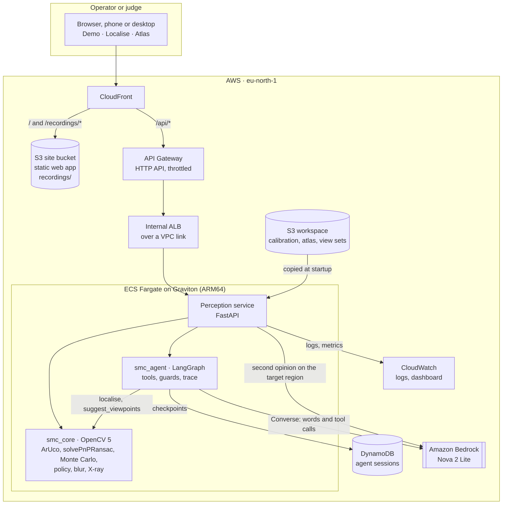
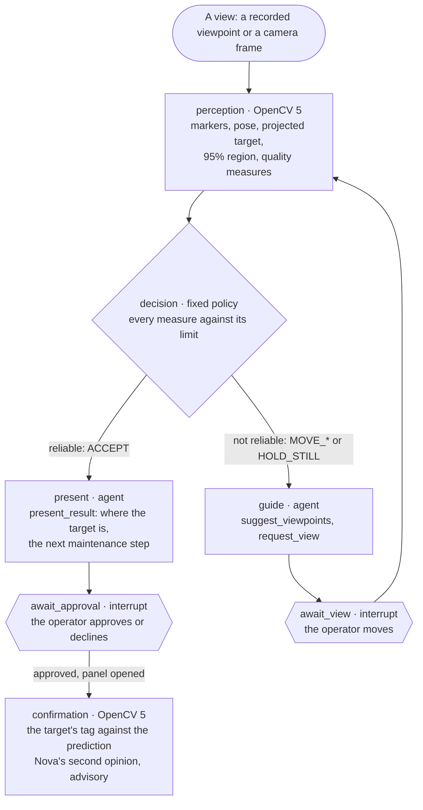

# Spatial Maintenance Copilot: technical report

Uncertainty-aware Agentic Vision for locating occluded components during maintenance.
OpenCV AI Competition 2026, powered by AWS. Agentic Vision path. Solo entry by Łukasz Olszewski
(Spatial Intelligence Lab).

|  |  |
|---|---|
| Live application | <https://d14b6iicnc69ik.cloudfront.net> (AWS eu-north-1, kept running until judging ends) |
| Code | <https://github.com/Lukols-Dev/Spatial-Maintenance-Copilot> |
| Video | linked from the Devpost entry |
| Evaluation | [eval/results/cabinet-aruco-2026-10-23/report.md](../eval/results/cabinet-aruco-2026-10-23/report.md), regenerated by `make eval` |

## Contents

1. [Summary](#1-summary)
2. [Problem and users](#2-problem-and-users)
3. [What the system does](#3-what-the-system-does)
4. [Architecture](#4-architecture)
5. [Agent workflow](#5-agent-workflow)
6. [OpenCV 5 implementation](#6-opencv-5-implementation)
7. [AWS deployment](#7-aws-deployment)
8. [Evaluation](#8-evaluation)
9. [Changes from the proposal](#9-changes-from-the-proposal)
10. [Limitations](#10-limitations)
11. [Responsible use](#11-responsible-use)
12. [Reproducing the results](#12-reproducing-the-results)
13. [Status](#13-status)

## 1. Summary

A technician often knows which part to reach but not where it sits behind the panel in front of them.
Spatial Maintenance Copilot estimates where a hidden component is in the current camera view, measures how
far that estimate can be trusted, and lets an agent decide what happens next. The agent either presents
the result for the operator's approval or asks for a better viewpoint and says which way to move.

The geometry is the source of spatial truth. OpenCV 5 finds the printed markers on the asset and computes
the camera pose, the projected target, the quality of the fit and a Monte Carlo 95% uncertainty region. A
fixed policy turns those measurements into a decision. The agent (LangGraph, with Amazon Nova 2 Lite on
Amazon Bedrock) acts on that decision through typed tools. It never produces a pose, a coordinate or a
confidence figure, and guards hold its words to the policy's decision.

The demonstrator is a white TV cabinet, 610 × 340 × 380 mm, with a box hidden behind its flap. The final
dataset has 27 viewpoints from 16 tripod spots. They were recorded apart from the views the atlas was built
from, and in every one of them the box is hidden. The truth for each viewpoint is the box's own printed tag,
seen from the same tripod spot once the flap is open.

| Result | Value |
|---|---|
| Target error, median (p90) | **1.7 px** (2.4 px): 2% of the box's projected radius |
| Truth inside the 95% region | **22 of 22** viewpoints with a truth (Wilson 95% interval 85–100%) |
| Wrong overlays accepted | **0** of 18 accepted results, and 0 in 41,788 trials with injected faults |
| Task success, agent loop | **25 of 25** sessions reach an accepted, correct result, with Nova in the loop and without it. The policy alone reaches 18 of 25 |
| Latency on AWS (Graviton) | **60 ms** a frame in the service; 279 ms round trip from Poland, with the upload |
| Running cost | about $1 a day for the always-on part; $2.68 from deployment on 21 October to 23 October |

A second dataset uses landmarks clicked by hand instead of markers (19 viewpoints). It gives a 3.4 px
median error, 12 of 12 truths inside the region and no wrong result accepted. There fewer viewpoints
localise, which shows the agent's value: it reaches a correct, accepted result in 19 of 19 sessions. The
policy alone reaches 4 of 19, and a random walk under the same policy 64%.

**What a judge can try** on the live application, without the cabinet:

- **Demo**: act as the operator on recorded viewpoints. The page shows every landmark, quality check,
  decision and agent turn, and the session's trace.
- **Localise → Recording**: play one of four phone recordings through the same loop the phone runs live.
  Every 0.2 s of video is posted to the service, and the page draws the overlay, the policy's move, the
  agent's words and, once the flap opens, the tag's check against the prediction.
- **Atlas**: inspect the Component Atlas, its landmarks and view sets.

## 2. Problem and users

Documentation says what a component does and roughly where it is. A video shows how someone else reached
it, and a vision-language model describes what is visible. None of them relates *this* camera to *this*
asset to a part that cannot be seen. Without that relation people open the wrong panel, take apart more
than they need, or rely on knowing one specific machine.

The users are industrial maintenance technicians, field-service engineers, robotics technicians and
equipment operators. They work on a known asset, often one they have not serviced before. The system is
built around one narrow, measurable question from the proposal:

> Can an Agentic Vision system use geometric uncertainty to guide a user toward camera viewpoints that
> improve the localisation of an otherwise hidden component?

## 3. What the system does

1. **Authoring, once per asset.** Printed 40 mm ArUco markers are stuck on the asset, and a tag on the
   target. Two short walk-around videos are recorded around a printed ChArUco board on the floor, one with
   the cover shut and one with it open. The board fixes the asset frame. From them the Component Atlas is
   built. It holds:
   - the 3D landmarks (the markers' corners), each with its uncertainty and the directions it was seen
     from;
   - the target's position, uncertainty and box;
   - the panels that can hide the target, and which landmarks move when one opens.
2. **Localising a view.** The markers found in the view give the camera pose (PnP with RANSAC). The pose
   gives the target's projection, the panel it is behind and a 95% uncertainty region.
3. **Deciding.** The policy holds every measurement against a threshold. If all pass, the result is
   reliable. Otherwise it picks one move from the geometry: MOVE_LEFT, MOVE_RIGHT, MOVE_CLOSER, MOVE_BACK,
   MOVE_UP or MOVE_DOWN. For example, it names the side from which turned-away landmarks were seen. A frame
   smeared by motion gets HOLD_STILL: the same view again, with the camera still.
4. **Acting.** The agent asks the operator for the move and names recorded viewpoints that lie that way.
   For a reliable result, it presents the result with the next maintenance step for approval. Every step
   is written to a trace.
5. **Confirming.** Once the operator approves and opens the panel, the target's tag comes into sight. Its
   centre is held against the prediction, and Amazon Nova can be asked for a second opinion on the
   target's region.

The **Localise** page runs this on a stream: the phone's camera, a video file, or one of the recordings
served for judges.

A live camera goes step by step:
- While the camera moves, nothing is sent.
- Once it has held steady for 0.6 s, or not moved for 2 s, frames are sent until three in a row give the
  same move.
- That move then stands, spoken once and handed to the agent once, until the camera moves again.

On a phone the camera takes the whole screen. Exit and the settings sit over its top. The instruction, the
agent's turn and its buttons sit over its bottom.

Over the image the page draws:
- the panel the target is behind, tinted and named;
- the target's 3D box, dashed through that panel;
- the 95% region;
- an arrow with the policy's move and the fact it follows from, spoken on request;
- once the panel is open, the target's tag in the arrow's place: how many pixels it lies from the
  prediction, and whether it falls inside a 95% region the policy finds stable and tight. A wide region
  confirms nothing, since any tag lies inside it.

The **Demo** page shows the same steps on recorded viewpoints, with every landmark and quality check. The
judge is the operator and picks the next view, as the proposal planned (§10.2). Both pages end in a summary
of the session, one row per view or instruction:
- what OpenCV measured;
- what the policy decided from it;
- what the agent did with that decision;
- what the operator did next.

## 4. Architecture



| Part | What it is | Code |
|---|---|---|
| `smc_core` | The geometry, deterministic and pure: no HTTP, no model | [packages/smc_core](../packages/smc_core) |
| `smc_agent` | The agent's graph, tools, guards and model adapters: Nova through Converse, and Claude through Messages, kept but unused | [packages/smc_agent](../packages/smc_agent) |
| `smc_perception` | The FastAPI service: reads the workspace, runs the geometry and the agent | [services/perception](../services/perception) |
| Web app | Static Next.js export; every number it shows comes from the service | [apps/web](../apps/web) |
| `smc_eval` | The evaluation on a frozen dataset | [packages/smc_eval](../packages/smc_eval) |
| Tools | Board and marker sheets, calibration, frame export, atlas building, the marker session, dataset freezing, evaluation | [tools](../tools) |
| Infrastructure | The AWS CDK app, tested on its synthesized template | [infra](../infra) |

The service never computes in its HTTP layer: it reads files, calls `smc_core` and `smc_agent`, and returns
typed pydantic models. The web app's API examples are checked against those models and rebuilt by the
service in the test suite, so the two sides cannot drift apart.

**One frame, end to end.** The browser draws the video frame at the camera's calibrated size into a
canvas, encodes it as JPEG and posts it to `/api/frames`. The service then:
1. refuses a frame that is not that size;
2. finds the markers, measures the frame's blur on them, localises it and runs the policy;
3. keeps the frame for the agent and the second opinion;
4. answers with the pose's quality, the projected target, its region, the panel it is behind, the
   decision, and the tag's check when the tag is in sight.

The page draws the answer over the video and hands each settled decision to the agent's session.

## 5. Agent workflow



**OpenCV's output decides the next action.** The graph goes to `present` or to `guide` on the policy's
decision about OpenCV's measurements, never on the model's judgement. The move the operator is asked for
also comes from the geometry, for example the side from which turned-away landmarks were seen. The model
words that decision and chooses which recorded viewpoints to suggest, through tools with strict, closed
schemas.

**A trace from the deployment.** This session ran on AWS on 2026-10-23, with Nova as the agent's model. Its
input was the "Too close" recording on the Localise page, and the events are read back from the session's
trace:

| Step | Kind | Node | Event |
|---|---|---|---|
| 1 | perception | localise | localised frame `c6df69327cb6` |
| 2 | decision | localise | not reliable, MOVE_LEFT: "4 inliers, needs ≥ 6"; "landmarks cover 0.1 % of the frame, needs ≥ 5 %"; landmarks m56 and m57 face away from the camera, seen from further left |
| 3 | tool | guide | `suggest_viewpoints` MOVE_LEFT |
| 4 | guard | guide | "the model wrote numbers": its words are replaced by the policy's |
| 5 | agent | guide | asked for MOVE_LEFT |
| 6 | human | await_view | the operator moved; frame `bdebe95c7d63` |
| 7 | perception | localise | localised frame `bdebe95c7d63` |
| 8 | decision | localise | reliable: ACCEPT |
| 9 | agent | present | presented the result for approval |

The geometry refused the first view, named the move, and the agent asked for it. When the model's wording
broke a rule, the guard replaced it. The next view was accepted, and the result waited for the operator.
The evaluation keeps one such trace for every session it runs
([eval/results/cabinet-aruco-2026-10-23/traces](../eval/results/cabinet-aruco-2026-10-23/traces)).

**Guards.** The agent's output is checked against three rules:
- a move that differs from the policy's;
- digits in the model's words;
- a viewpoint that does not exist.

The guard replaces or drops the output and records a `guard` event.

**Fallback.** When the model is unreachable, refuses, or calls no ending tool within 4 calls, the operator
gets the policy's own words. The trace records a `fallback` event, and the session never waits on the model.
A cap of 1000 model calls a UTC day bounds the cost, past which the same fallback applies.

**Human control.** The graph stops (LangGraph `interrupt`) for every move and for the final approval, and
nothing proceeds without the operator. A checkpointer keeps the session between requests: DynamoDB on AWS,
memory locally.

**Observability.** Every node appends numbered trace events: `perception`, `decision`, `agent`, `tool`,
`guard`, `fallback` and `human`. The Demo and Localise pages show them under the session's summary. On AWS
the service's logs go to CloudWatch, and a dashboard shows requests, errors, latency, CPU and memory.

## 6. OpenCV 5 implementation

All geometry runs on `opencv-python-headless` 5.0.0.93, in the service and in the evaluation alike.

**Camera calibration.** An iPhone 11 was calibrated at 1×, 1080 × 1920 portrait, from 58 frames of a 5 × 7
ChArUco board. The RMS reprojection error is 0.90 px. Distortion is modelled by OpenCV's 5-coefficient
model, and every frame is checked to have the calibrated size before its pixels are used. APIs:
`cv.aruco.CharucoDetector`, then `cv.calibrateCameraExtended` on the matched board points, which also gives
each parameter's standard deviation.

**The rig board and the asset frame.** A 4 × 6 ChArUco board with 25 mm squares (rig board B) lies flat on
the floor in front of the asset and defines its frame. For the final session it was a fresh print of the
same pattern on plain A4 paper, flat enough that its thickness is ignored; the substrate noted in
`calib/rig.yaml` describes the earlier foam-board print. A frame's camera pose comes from the board:
`CharucoDetector.detectBoard`, `matchImagePoints`, `solvePnP` (IPPE) and `solvePnPRefineLM`.

**Markers.** DICT_5X5_100 markers, 40 mm a side: IDs 50–57 on the cabinet and ID 70, the tag, on the
box.
- m50–m53 sit on the flap's corners, m54–m55 on the top and m56–m57 on the left side.
- They are found by `cv.aruco.ArucoDetector` with sub-pixel corner refinement, and each corner is a
  landmark.
- The flap's markers move when it opens. The atlas marks them as moving, so they are left out of any
  frame that shows the tag.

**Building the atlas.** The two walk-arounds gave 264 frames with the board.
- 12 frames were dropped because their board pose disagreed with where the other frames put the same
  markers by 10 px or more. One of them was a mirrored board pose 332 px off.
- Each corner is triangulated from the 252 remaining posed frames it is seen in. Its σ comes from Monte
  Carlo over the corner noise (1 px) and the board pose's own spread, and the build records the directions
  it was seen from.
- The target is the tag's centre, with a 150 × 65 × 140 mm box oriented by the tag and placed behind it.

| Atlas v2 (2026-10-23) | σ of the loosest corner |
|---|---|
| flap, m50–m53 | 0.7–1.0 mm |
| top, m54–m55 | 0.8–0.9 mm |
| left side, m56 / m57 (seen in 48 and 29 frames, obliquely) | 3.8 mm / 8.4 mm |
| target, the tag's centre | 2.2 mm |

**The panels.** A plane is fitted through the markers on each face. Together they give the cabinet's box:
the flap, the top and the left side measured, and the right side placed the tape-measured width away. The
fitted height is 383.4 mm against 380 mm by tape. Against the atlas built from an earlier recording
(2026-10-15), the 28 shared points agree to an RMS of 2.8 mm after a similarity fit, at a scale of 1.0015.
The flap's m50 moved by 3.6 mm between the two builds, because the flap does not shut to the same place
twice.

**Localisation.** The pose comes from `cv.solvePnPRansac` (SQPnP, 8 px threshold), then
`cv.solvePnPRefineLM` on the inliers. `cv.projectPoints` gives the target's point and box. Quality measures:
- inliers and inlier ratio;
- RMS and maximum reprojection error;
- image coverage of the inliers' convex hull (`cv.convexHull`, `cv.contourArea`);
- non-planarity of the landmarks.

**Uncertainty.** Monte Carlo samples perturb every inlier observation by its σ in pixels, every landmark by
its σ in mm, and the target by its σ: 500 samples in the evaluation, 200 on a live frame. Each sample refits
the pose (`cv.solvePnP`, iterative, from the estimate) and reprojects the target. The 95% ellipse is the
χ²(2) quantile of the samples' covariance. A second, pose-only ellipse keeps the target at its atlas
position and shows the part a better viewpoint can shrink.

**Decision policy.** A localisation is reliable only when all of these hold:
- ≥ 4 landmarks and ≥ 6 inliers;
- inlier ratio ≥ 0.75;
- RMS reprojection ≤ 3 px;
- inlier coverage ≥ 5% of the frame;
- ≤ 5% failed Monte Carlo samples;
- the 95% region's semi-major axis ≤ 0.5 × the target's projected radius;
- the target is in frame;
- for a frame of a camera or a video, its markers' edges are ≤ 5.5 px wide (below).

The move comes from geometry:
- a failed pose asks to step back;
- a target out of frame asks to bring it in;
- landmarks that face away from the camera ask to move toward where the atlas saw them from.

A blurred frame is checked first and asks to hold the camera still, since whatever else it shows is
smeared too.

**X-ray view.** The atlas lists the asset's panels, flat faces such as the flap and the sides. The line of
sight from the camera to the target is intersected with them. The panel it crosses is the one the target is
behind; it is named and tinted in the frame. The target is drawn as its 3D box, dashed while it is hidden.

**Confirmation.** With the tag in sight, its centre (the crossing of its diagonals) is held against the
projected target. It confirms the prediction only if it falls inside a 95% region that the policy finds
stable and tight.

**Step by step on a live camera.** A hand-held camera never stops quite still, and the policy's move flips
at its own thresholds. Analysing every frame turned that into an arrow flicking left and right as the hand
shook.

The page therefore tells the camera's motion from its own picture before anything is sent:
- each frame is drawn 160 px on its longer side, in grey;
- its change is the mean absolute difference from the frame before, less the two frames' mean brightness,
  since a phone facing a white cabinet keeps changing its exposure.

On the walk-arounds (`tools/motion_limit.py`, 1673 pairs of consecutive frames with markers), this change
ranks the pairs as the markers' own motion does (Spearman 0.94):

| Markers' motion between frames (px) | Pairs | Change, p10 | Median | p90 |
|---|---|---|---|---|
| 0–0.5 | 145 | 0.46 | 0.55 | 0.68 |
| 0.5–1 | 257 | 0.57 | 0.71 | 1.04 |
| 1–2 | 330 | 0.80 | 1.05 | 1.55 |
| 2–4 | 384 | 1.41 | 1.94 | 2.77 |
| 4–8 | 371 | 2.23 | 3.02 | 4.08 |
| 8–16 | 183 | 3.47 | 4.61 | 5.63 |

The Camera app steadies its picture, but a browser's camera does not: a hand holding a phone "still" moves
it a few pixels a frame. The camera therefore counts as moving only above 3.5, which covers 89% of the pairs
whose markers moved 8 px or more. It counts as steady below 2.5, which covers 94% of those that moved under
4 px. The change is taken as its median over 0.3 s, so one shaken frame is no move. A recorded video is
stepped 0.2 s at a time instead.

**Motion blur.** A frame taken while the camera moves localises with a small reprojection error and a pose
that is off all the same. Every marker is smeared the same way, so the fit stays consistent while the target
jumps, and no check of the fit sees it. The blur is therefore measured on the markers themselves:
- A marker is the same black and white print in every frame, so the width of its edges measures the
  frame, not the scene. The variance of the Laplacian, by contrast, grows with texture and falls with
  resolution.
- Around each marker found, the rise from its black to its white (5th to 95th intensity percentile) is
  divided by the steepest slope (98th percentile of the Sobel derivative), along eight directions.
- The widest direction is kept, and the frame's width is the median over its markers (`smc_core.blur`).
- On rendered frames a still camera reads 2.8 px, and a motion of n pixels in any direction reads within
  15% of n.

The limit is calibrated on two walk-arounds (`tools/blur_limit.py`, 846 frames with markers). The target's
jitter is its distance from the mean of the frames before and after, which a smooth camera path cancels:

| Edge width (px) | Frames | RMS reprojection, median (px) | Jitter, median (px) | Jitter, p90 (px) | Accepted without the blur check |
|---|---|---|---|---|---|
| below 3.5 | 285 | 0.56 | 0.35 | 0.77 | 49% |
| 3.5–4 | 170 | 0.70 | 0.58 | 2.92 | 71% |
| 4–4.5 | 127 | 1.11 | 0.74 | 2.62 | 81% |
| 4.5–5 | 95 | 2.34 | 0.76 | 2.56 | 63% |
| 5–5.5 | 55 | 1.02 | 0.81 | 3.35 | 65% |
| 5.5–6 | 33 | 1.30 | 1.56 | 10.01 | 52% |
| 6–7 | 53 | 1.72 | 2.24 | 7.14 | 43% |
| 7–8 | 13 | 1.01 | 4.07 | 16.06 | 46% |
| 8–10 | 13 | 0.55 | 9.25 | 25.89 | 8% |
| 10 and over | 2 | 0.50 | 13.69 | 15.14 | 0% |

The reprojection error does not grow with blur, but the jitter does. From 5.5 px its 90th percentile leaves
the 95% region of these frames (a semi-major axis of 6.0 to 8.6 px between its quartiles). Yet without this
check the policy accepted 43–52% of the frames between 5.5 and 8 px, which means overlays in the wrong place.
With `max_edge_width_px = 5.5`, the policy holds 114 of the 846 frames still.

**Model-based tracking (tried, not used).** `cv.rapid` (Rapid, OLS and GOS trackers from opencv-contrib 5.0)
was tried for markerless tracking of the cabinet from its box shape, the idea behind Vuforia Model Targets.
On this scene it failed: one tracking step from the true pose ended 220–530 mm away. The cabinet's
silhouette is hidden by a TV and books, and it is white against a white wall.

## 7. AWS deployment

The application runs on AWS as one CDK stack in eu-north-1 ([infra/](../infra)). The stack is tested on its
synthesized template and has served the live application since 21 October 2026.

| Layer | AWS service |
|---|---|
| Judge-facing web app and recordings | S3 + CloudFront, the same origin as the API, so a canvas can read the served videos' frames |
| API entry point | API Gateway HTTP API, throttled at 20 requests/s (burst 40), private integration over a VPC link |
| Perception service and agent | ECS Fargate on Graviton (ARM64, 1 vCPU, 2 GB), behind an internal Application Load Balancer |
| Component Atlas, camera, view sets | S3, copied into the container at startup; the service runs read-only |
| Session state and agent trace | DynamoDB through LangGraph's `DynamoDBSaver`; sessions expire after a week |
| Model inference | Amazon Bedrock, Nova 2 Lite in the EU, signed by the task role and allowed this model only |
| Logs and metrics | CloudWatch: container logs, Container Insights, a dashboard of requests, errors, latency, CPU and memory |
| Credentials | IAM roles only: no long-lived key is stored in AWS |
| Cost control | a cap of 1000 model calls a UTC day; an AWS Budgets alert by email at 80% of a $60 monthly budget and at a forecast 100% |

**Measured on the deployment** (23 October 2026, frames of the "Too close" recording, 1080 × 1920 JPEG of
about 270 KB):

| Measure | Median | p90 | Max |
|---|---|---|---|
| Localisation in the service, per frame (200 Monte Carlo samples) | 60 ms | 65 ms | 66 ms |
| Round trip from a browser in Poland, upload included | 279 ms | 328 ms | 362 ms |

In Chrome on the live site, the first 25 s of that recording posted 97 frames, and all of them were answered
(HTTP 201). The decision went from MOVE_LEFT to ACCEPT, and the session ended with the tag 1.8 px from the
prediction, inside its 95% region.

**Cost.** The always-on part costs about $1 a day: the Fargate task, the load balancer and the VPC. Bedrock
calls add cents. From the first deployment on 21 October to 23 October, the account spent $2.68 before
credits:

| Service | Cost |
|---|---|
| ECS | $1.43 |
| Elastic Load Balancing | $0.81 |
| Bedrock | $0.25 |
| VPC | $0.17 |
| Cost Explorer | $0.02 |

Running until judging ends on 10 November stays well inside the competition's compute grant.

**Deploying.** `make deploy` builds the web app for `/api` and the ARM64 image, then deploys the stack. The
four recordings are uploaded from `data/recordings/`, not from git, and only when they are present.
`infra/cdk.json` names the atlases and view sets of `data/` that the deployment serves. The stack's outputs
give the site's URL, the bucket, the sessions table and the service's log group.

## 8. Evaluation

### 8.1 Datasets and protocol

The evaluation plan of the proposal (§9) is implemented in `smc_eval`. It runs the service's own code on a
frozen dataset. A dataset holds the atlas, the clicks and the board poses, with the SHA-256 of every file and
of every private source video (`tools/freeze_dataset.py`). The test viewpoints are always recorded apart from
the views the atlas was built from, and they show the target hidden.

| Dataset | Landmarks | Test viewpoints | Truth | Role |
|---|---|---|---|---|
| [cabinet-aruco-2026-10-23](../eval/datasets/cabinet-aruco-2026-10-23) | ArUco markers, found automatically | 27 from 16 tripod spots, 22 with a truth | the box's tag in the open frame of the same tripod clip | **main result** |
| [cabinet-manual-2026-10-09](../eval/datasets/cabinet-manual-2026-10-09) | six pen-drawn crosses, clicked | 19 hand-held, 14 with a truth | the box clicked in the open shot | manual baseline (proposal §5) |
| [cabinet-aruco-2026-10-15](../eval/datasets/cabinet-aruco-2026-10-15) | ArUco markers | 6 hand-held | the box clicked in the open shot | inconclusive, re-recorded (§8.8) |

**The tripod protocol (2026-10-23).** At each spot the phone recorded one continuous clip on a tripod: 5 s
with the flap shut, the flap opened, 5 s open, the flap shut again, 5 s. `tools/viewpoint_clips.py` finds the
still stretches by the change in the picture, the same measure the Localise page uses.
- The shut stretch gives the test viewpoint (`Tn_close`).
- The open stretch gives the truth (`Tn_open`), the tag's centre found by ArUco.
- The shut-again stretch gives a repeat of the viewpoint (`Tn_2_close`), kept only if the camera is back
  within 1 px.

Three spots (T13, T15, T16) are kept without a truth, because the tag is out of sight from them once the flap
opens. One spot (T14) saw no marker at all and is left out.

**The truth carries the tripod's own motion.** Opening the flap means stepping up to the cabinet, and the
floor flexes under the tripod. The camera's shift between the shut and the open frame is measured on the
markers that do not move with the flap: a median 0.57 px, between 0.28 and 1.14 px. That is the same order
as the localisation error itself (median 1.7 px), so part of every error below is the tripod moving, not
the method.

| Spot | T01 | T02 | T03 | T04 | T05 | T08 | T10 | T11 | T12 | T13 | T15 | T16 |
|---|---|---|---|---|---|---|---|---|---|---|---|---|
| Shift, shut to open (px) | 0.34 | 0.33 | 0.40 | 0.88 | 0.86 | 0.66 | 0.42 | 0.82 | 1.14 | 0.28 | 0.57 | 0.98 |

T06, T07, T09 and T17 show no marker off the flap once it is open, so their shift cannot be measured. For
the first three, the shut frames before and after the opening agree to 0.41–0.78 px.

### 8.2 Localisation

| Measure | Markers, 2026-10-23 | Clicked, 2026-10-09 |
|---|---|---|
| Viewpoints with a truth, localised | 22 of 22 | 12 of 14 |
| Target error, median / p90 / max | **1.7 / 2.4 / 13.7 px** | 3.4 / 7.9 / 13.8 px |
| Target error of accepted results, median / max | 1.6 / 2.5 px (18 results) | 2.5 / 3.9 px (4 results) |
| Error / the target's projected radius, median | 0.02 | 0.03 |
| RMS reprojection, median | 0.77 px | 0.58 px |
| 95% region, semi-major axis, median | 6.3 px | 17.1 px |
| Truth inside the 95% region | **22 of 22** (85–100%) | 12 of 12 (76–100%) |

The markers halve the error and shrink the region nearly threefold against clicked crosses, and they need no
clicking. The largest error, 13.7 px, is T17, a view with a single marker: there the region's semi-major axis
is 98 px, and the policy asks to move up.

### 8.3 Uncertainty calibration

The region is conservative. The truth's median squared Mahalanobis distance is 0.33, against 1.39 for a
calibrated region, so at the median the error is 0.49 of the spread the region assumes. Changing the Monte
Carlo seed (seeds 0–4) moves the semi-major axis by a median 4.7% (at most 18.3%), and it never changes a
verdict on the truth or a decision.

### 8.4 Decisions against the truth

|  | Truth inside | Truth outside |
|---|---|---|
| Accepted | 18 | **0** |
| Asked to move | 4 | 0 |

No wrong result was accepted (0 of 18, Wilson 0–18%). The policy trades availability for safety: it asked to
move in 4 viewpoints whose truth was already inside the region.
- T06 (twice) and T11: the landmarks cover less than 5% of the frame.
- T17: a single marker.

Of the five viewpoints without a truth, the policy accepted T13 (from both shots) and asked to move from T15
and T16.

### 8.5 Pose stability

**Repeats from the same spot.** In 11 pairs (shut, opened, shut again), the projected target moved a median
0.5 px and at most 0.8 px. The camera centre moved a median 1.0 mm. The largest move, 14.3 mm, was T08,
from 2 m away.

**The landmarks' pose against the board's.** In 18 held-out frames that also show the rig board, the two poses
differ by a median 35.5 mm and 2.1°. That would move the target 15.8 px, yet the tags put the landmarks'
target 1.7 px from the truth. So the board's pose is the weaker one here: the board lies on the floor at
the bottom edge of the tripod's frame, seen at a grazing angle through 8–15 corners. On the clicked dataset
this check gave 5.6–5.9 mm and 0.2°. In the atlas's own 252 frames the median is 15.9 mm, and a single
frame's board pose is flipped (137°).

### 8.6 Task success and the agent

A simulated operator runs sessions through the real agent graph, from every viewpoint, at most 4 viewpoints
each. Success means a result accepted with the truth inside its region.

| Strategy | Markers: success | Markers: refused | Clicked: success |
|---|---|---|---|
| Single view, no policy | 22/22 | 0/27 | 12/19 |
| Policy only | 18/25 (72%) | 7/27 | 4/19 |
| **Agent loop** | **25/25**, 1.3 views on average | 0/27 | **19/19**, 2.5 views on average |
| Random walk under the policy | 2426/2430 | 4/2700 | 64% |

- **Single view** shows every overlay, whatever its quality. On these datasets it was never wrong, but it is
  the strategy that injected faults break (§8.7).
- **Policy only** is safe, but it refuses 7 of the 27 marker starts and 15 of the 19 clicked ones.
- **The agent** recovers all of them by asking for the policy's move and naming a viewpoint that way.
- **A random walk:** on the marker dataset nearly every viewpoint localises well, so a random next view does
  as well as the agent. On the clicked dataset fewer views localise, and there the agent's measured
  direction matters: 19 of 19 against 64%.

**The agent's next view** (markers, the 4 starts asked to move from):
- the region shrank in 4 of 4;
- the next view was accepted in 3 of 4;
- the error fell in 2 of 4, from starts whose errors were already 1.6–2.2 px.

From T17, the agent's view (T06) itself asked to move on, and the session ended accepted at T07. On the
clicked dataset, the agent's next view lowered the error in 7 of 8 starts.

**With the model.** By default the evaluation runs the agent without a model, so its words are the policy's
own and the run is reproducible: the 35 turns of its 27 sessions are all fallbacks. The same evaluation was
also run with Nova 2 Lite as the agent's model
([cabinet-aruco-2026-10-23-with-model](../eval/results/cabinet-aruco-2026-10-23-with-model/report.md)):

|  | Without a model | With Nova 2 Lite |
|---|---|---|
| Sessions reaching an accepted, correct result | 25/25 | 25/25 |
| False accepts | 0 | 0 |
| Turns the model answered | 0 of 35 | 35 of 35 |
| of them corrected by a guard | — | 17, every one for digits |
| Turns in the policy's own words (fallback) | 35 | 0 |

The outcomes are the same because the branch and the move belong to the policy; the model changes the
words, never the path. Nova answered every turn. In 17 of them its words contained digits, and the guard
replaced them with the policy's sentence. The rule is strict on purpose: any digit counts, including those
of a landmark's name such as m56_0, and the policy's reason hands the model those names.

### 8.7 Failure handling

**Injected faults** go into every viewpoint that localises and has a truth. "Unsafe" means accepted with the
truth outside its region, an overlay in the wrong place. The last column counts what a system without the
policy, showing every overlay, would have drawn in the wrong place.

| Fault (markers) | Trials | No result | Asked to move | Accepted, truth inside | Unsafe | Drawn, truth outside |
|---|---|---|---|---|---|---|
| Three landmarks, one short of a pose | 36,104 | 36,104 | 0 | 0 | **0** | 0 |
| Two labels swapped | 4,804 | 0 | 128 | 4,676 | **0** | 8 |
| One click 60 px off, on the wrong feature | 440 | 0 | 32 | 408 | **0** | 4 |
| Every click off by the click σ | 220 | 0 | 40 | 180 | **0** | 0 |
| Every click off by 3σ | 220 | 0 | 214 | 6 | **0** | 13 |

On the clicked dataset the same faults ran 570 trials, with 0 unsafe; a system without the policy would have
misplaced 62 overlays.

**The failure cases the proposal named (§6)**, and how each one is handled:

| Failure case | How it is handled | Evidence |
|---|---|---|
| Too few correspondences | Fewer than 4 landmarks give no pose. Fewer than 6 inliers are not reliable, and the operator is asked to step back or move toward the landmarks | Three landmarks: no result in all 36,104 trials. T17 (one marker): MOVE_UP |
| Degenerate landmark geometry | Inlier coverage ≥ 5% of the frame, non-planarity, and the region's size against the target's | T06 and T11, whose landmarks cover under 5%: MOVE_LEFT, and the agent's next view is accepted |
| Low inlier ratio | RANSAC at 8 px, inlier ratio ≥ 0.75 | Swapped labels and gross clicks: 0 unsafe in 5,244 trials |
| Excessive reprojection error | RMS ≤ 3 px | Noise at 3σ: 214 of 220 trials asked to move, 0 unsafe |
| Motion blur or unusable frames | The markers' edge width ≤ 5.5 px, else HOLD_STILL. A frame of the wrong size is refused. With no markers, the operator is asked to step back | 114 of 846 walk-around frames held still (§6). T15 below |
| Unstable pose estimates | ≤ 5% failed Monte Carlo samples, the region's semi-major axis ≤ 0.5 × the target's radius, and live, a move must hold for three frames | Monte Carlo seeds change no decision. Repeats move the target 0.5 px |

### 8.8 Failure cases observed

- **The marker dataset of 15 October is inconclusive.** Its six viewpoints were shot by hand, and the truth
  shots moved: between T3's shut and open shots the camera moved 94 mm and turned 3.9°, so its "error" of
  79 px was largely the camera. T6, whose camera moved 0.6 mm, has a 2.4 px error, inside its region.
  Overall 2 of 6 truths fell inside the region. That led to the tripod protocol above. The results stay in
  the repository ([eval/results/cabinet-aruco-2026-10-15](../eval/results/cabinet-aruco-2026-10-15/report.md)).
- **Foreshortened markers read as blur.** At T15, from far to the left, the markers are seen nearly edge-on.
  Their edges measure 7.6 px wide although the frame is sharp, so the live path says HOLD_STILL where the
  geometry asks to move right. The edge-width measure assumes markers seen roughly face-on.
- **No marker, no pose.** At T14 the camera saw no marker, and the only possible instruction is to step back.
- **The side markers are the atlas's weakest landmarks.** m56 and m57 are located to 3.8 and 8.4 mm,
  because the walk-arounds saw them obliquely and in few frames. The session tool's verdict was to film them
  again, which the deadline did not allow.
- **A panel does not shut to the same place twice.** The flap's m50 differs by 3.6 mm between the two atlas
  builds. A prediction behind a panel assumes the panel shut where the atlas saw it.
- **The board check is weak in tripod views** (§8.5).
- **The second opinion can be asked too early.** In the live recording shown in the video, the operator
  asked for Nova's second opinion before opening the flap. Nova answered "Yes, a small rectangular object is
  visible on the surface": it described the handle. The atlas gives the target no description, so the
  question is the generic "Is the hidden component visible in this region?". The answer changes nothing,
  being advisory, but the button should wait for the tag.
- **The model's wording is checked for rules, not meaning.** In the same session Nova wrote "The hidden
  component is now visible in your current view" before the flap was open. The guards catch a wrong move,
  numbers or an unknown viewpoint; they do not catch a wrong claim in plain words.

### 8.9 Reproducibility

`make eval-check` reruns the evaluation and compares it with the stored results, within fixed tolerances:
0.5 px, 1 mm, 0.2° and 2% otherwise. Counts and verdicts must match exactly. On the final code it reproduces
all three datasets. Seeds, versions, the git commit and the dataset's manifest hash are recorded in each
`results.json`. The main result was run on a clean tree at commit `993157b`.

## 9. Changes from the proposal

| Proposal | Now | Why |
|---|---|---|
| A vehicle with a hidden washer-fluid pump | A cabinet with a box behind its flap | A rigid asset at home allows repeatable viewpoints, open and closed states for ground truth, and many sessions. A new asset needs only a new atlas (proposal §11). |
| Manual landmark selection first, automation after validation | Done in that order: the clicked baseline was evaluated, then printed ArUco markers replaced the clicks | The proposal's own order (§5). Markers are found in every frame with sub-pixel corners, which makes live camera and video use possible. |
| The judge picks recorded viewpoints; a live session by screen sharing | Both kept: the Demo page, plus the Localise page playing four recordings through the live loop. The live phone session is shown in the video | Choosing frames shows the decisions; a recording shows the loop as it runs on a phone. |
| Tracking between nearby frames where useful | Every frame is localised on its own in 60 ms. The page tells the camera's motion from its picture, and `cv.rapid` was tried and rejected (§6) | Measured, not assumed. |
| Claude through Bedrock | Amazon Nova 2 Lite through the Converse API | The account's credits do not cover Claude (Marketplace). The adapter for Claude stays in the code. |
| IAM roles and Secrets Manager | IAM roles only | No long-lived secret exists on AWS: the task role signs every Bedrock call, so Secrets Manager has nothing to hold. |
| A tool interface possibly exposed over MCP | Typed LangGraph tools, no MCP | Optional in the proposal, and the agent runs inside the service. |
| ARM/Graviton or COOL as an optional benchmark | The service runs on Graviton (ARM64). COOL is not used, and the entry does not opt into the COOL award | Optional in the proposal. |
| An outline of the asset from a recorded "guide view" to line up with | Built, then removed | It was a second source of direction beside the policy's measured move, which it could contradict, and on the phone it read as an object in the scene. |

## 10. Limitations

- **One asset, one phone, a few sessions.** The final test set has 27 viewpoints, so every rate carries a
  wide interval, and the intervals are reported.
- **Markers are needed on this asset.** The cabinet is white and its silhouette is occluded, so neither
  natural features nor model-based edge tracking held. An asset with texture or a CAD model could do
  without them.
- **A camera must be the calibrated one.** Frames are refused unless they have the calibrated size. The
  intrinsics hold for the iPhone 11's 1× 1080p video. A browser camera in another mode, or a laptop's
  webcam, needs its own calibration (`tools/calibrate_camera.py`).
- **The region is conservative and the policy cautious.** The policy asked to move in 4 viewpoints whose
  truth was already inside the region. Views with fewer than 6 inliers are never accepted.
- **The blur limit is in this camera's pixels,** from one session's walk-arounds, and foreshortened markers
  read as blur (§8.8).
- **Without a pose, the agent leans on what was recorded.** From a viewpoint with too few markers, the agent
  names the recorded viewpoints that see the most landmarks. On a live camera there are none, and the policy
  can only ask to step back.
- **The truth is measured, but it carries the tripod's motion,** up to 1.1 px (§8.1).
- **One process keeps the frames.** Posted frames are kept in the service's memory, so the agent's live
  sessions need the single task the deployment runs.

## 11. Responsible use

- **No narrated confidence.** The model never states a number: a guard replaces any wording with digits,
  and every figure on screen is a measurement or a threshold.
- **A wrong overlay counts as a failure.** An unreliable result is drawn in a warning style, hatched and
  dashed, so it is never mistaken for a reliable one. The evaluation counts every accepted overlay with the
  truth outside as a failure, and there were none.
- **Human approval.** No step is taken without the operator: every move and the final next step wait for
  them.
- **The vision model gives words only.** Its answer starts with yes or no and carries no numbers; an answer
  with numbers keeps only its yes or no. It is shown as a second opinion and changes no decision, which
  matters given §8.8.
- **Data.** The recordings show the inside of a private home.
  - Four short clips of the cabinet are served to judges by the deployment.
  - Every other recording stays out of the repository and is referenced by hash only.
  - Clicks, atlases and board poses carry no personal data.
- **Secrets.** Locally, the model's keys live in `services/perception/.env`, which git and Docker ignore. The
  service checks them at startup and logs only a masked key id. On AWS no key exists: the task role signs,
  and it may call only the agent's model. Model and AWS error details go to the server log, not to the
  trace that visitors see.
- **Abuse and cost.** The API is throttled. Model calls are capped per day, and past the cap the agent uses
  the policy's words. A budget alert watches the account.
- **Region.** Bedrock calls stay in the EU (eu-north-1).

## 12. Reproducing the results

Requirements: [uv](https://docs.astral.sh/uv/), Node.js 20.9+ and Docker; for deploying, AWS credentials
and access to Amazon Nova 2 Lite in eu-north-1.

```bash
make setup        # the uv workspace, the web app, the git hooks
make check        # lint, types, unit and API tests: 778 Python, 291 web and 13 infrastructure tests
make e2e          # browser tests of the web app
make eval         # the evaluation on the main frozen dataset: results, report, traces
make eval-check   # rerun and compare with the stored results
make eval EVAL_DATASET=eval/datasets/cabinet-manual-2026-10-09   # the clicked baseline
make synth        # the AWS stack's template
make deploy       # the web app built for CloudFront, the ARM64 image, the stack
```

The evaluation needs neither the private videos nor AWS: a frozen dataset holds everything it reads, and
`tools/freeze_dataset.py --verify` checks the videos' hashes where they are present. All dependencies are
pinned: `uv.lock` for Python 3.14 and the `package-lock.json` files for the web app and the AWS stack.

## 13. Status

**Built, tested and deployed:**
- calibration, the rig board, printed markers, atlas building with its panels;
- localisation, uncertainty, the decision policy and the X-ray view;
- the agent loop with Nova: tools, guards, fallbacks, interrupts for the operator, and the trace;
- the Demo, Localise and Atlas pages:
  - step by step on a live camera, full screen on a phone;
  - the four recordings for judges;
  - the tag's confirmation when the panel opens, with Nova's second opinion;
- motion blur measured on every frame's markers, with HOLD_STILL;
- the evaluation on three frozen datasets, reproducible within tolerances;
- the AWS deployment, live since 21 October 2026.

**Not built:** an MCP interface, COOL, and markerless tracking (tried with `cv.rapid` and rejected).
