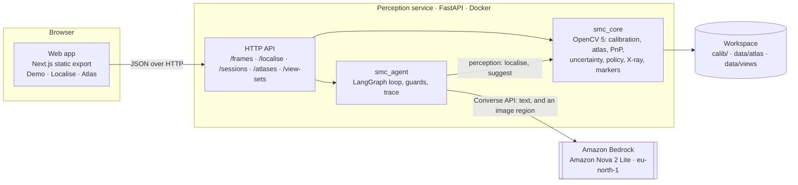
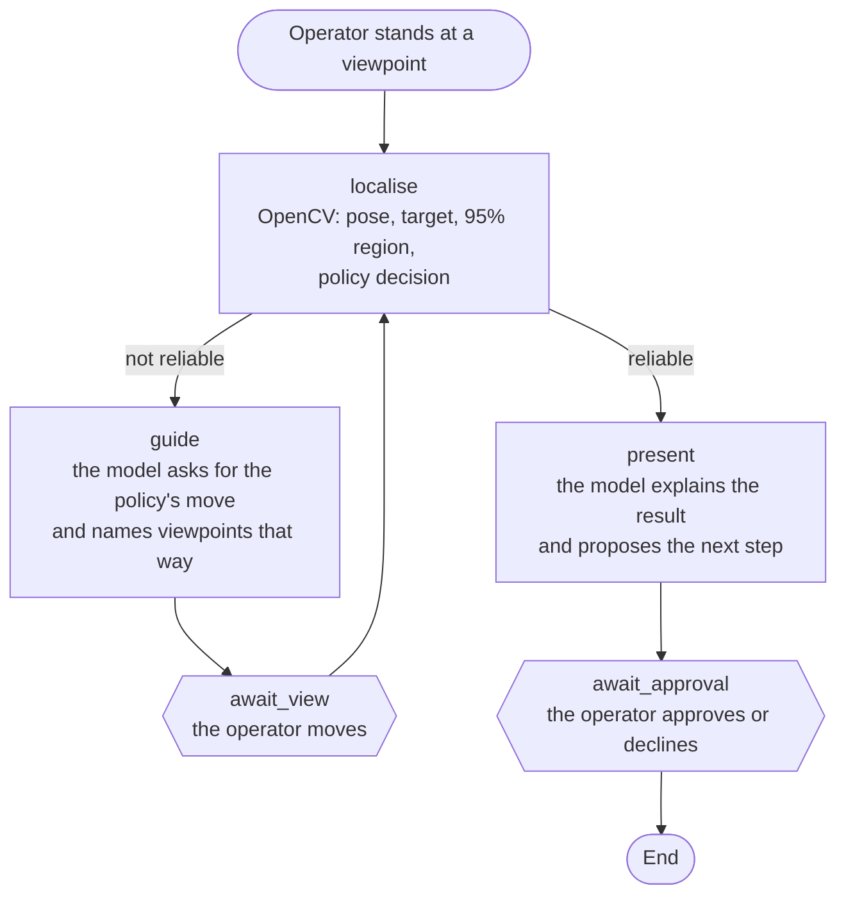
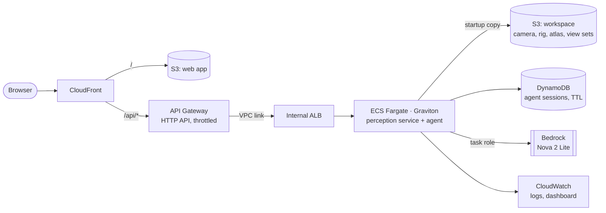

# Spatial Maintenance Copilot: technical report

Uncertainty-aware Agentic Vision for locating occluded components during maintenance.
OpenCV AI Competition 2026 (powered by AWS), Agentic Vision path. Solo entry by Łukasz Olszewski.

> **Working draft, 2026-10-14.** Each section says what runs today and what is still being built.
> Numbers are quoted from [eval/results/cabinet-manual-2026-10-09/report.md](../eval/results/cabinet-manual-2026-10-09/report.md),
> which `make eval` regenerates.

## Contents

1. [Summary](#1-summary)
2. [Problem and users](#2-problem-and-users)
3. [What the system does](#3-what-the-system-does)
4. [Architecture](#4-architecture)
5. [Agent workflow](#5-agent-workflow)
6. [OpenCV 5 implementation](#6-opencv-5-implementation)
7. [AWS deployment](#7-aws-deployment)
8. [Evaluation](#8-evaluation)
9. [Design decisions and changes from the proposal](#9-design-decisions-and-changes-from-the-proposal)
10. [Limitations](#10-limitations)
11. [Responsible use](#11-responsible-use)
12. [Reproducing the results](#12-reproducing-the-results)
13. [Status](#13-status)

## 1. Summary

A technician often knows which part to reach but not where it sits behind the panel in front of them.
Spatial Maintenance Copilot estimates where a hidden component is in the current camera view, measures how
far that estimate can be trusted, and lets an agent decide what happens next. The agent either presents
the result for the operator's approval or asks for a better viewpoint and says which way to move.

The geometry is the source of spatial truth. OpenCV 5 computes the camera pose, the projected target, the
quality of the fit and a Monte Carlo uncertainty region. A fixed policy turns those measurements into a
decision. The language model never produces a pose, a coordinate or a confidence figure. It explains the
policy's decision and acts through typed tools, and guards hold its output to that decision.

The demonstrator is a cabinet (IKEA BESTÅ, 600 × 400 × 372 mm) with a box hidden behind its flap. On
viewpoints recorded apart from those the atlas was built from:

- the hidden box is localised with a median error of **3.4 px** (2.5 px when accepted);
- the 95% region holds the truth in **12 of 12** localised viewpoints;
- the policy accepted **no** wrong result, including under 570 injected faults;
- the agent's loop reaches an accepted, correct result in **19 of 19** sessions, 12 of them from
  viewpoints that localise and 7 from viewpoints that do not. The policy alone manages 4 of 19, and a
  random walk under the same policy 64%.

## 2. Problem and users

Documentation says what a component does and roughly where it is; a video shows how someone else
reached it; a vision-language model describes what is visible. None of them relates *this* camera to
*this* asset to a part that cannot be seen. Without that relation people open the wrong panel,
disassemble more than needed, or rely on familiarity with one specific machine.

The users are industrial maintenance technicians, field-service engineers, robotics technicians and
equipment operators: people who work on a known asset, often one they have not serviced before. The
system is built around one narrow, measurable question from the proposal:

> Can an Agentic Vision system use geometric uncertainty to guide a user toward camera viewpoints that
> improve the localisation of an otherwise hidden component?

## 3. What the system does

1. **Authoring, once per asset.** A Component Atlas is built from video of the asset taken around a
   printed ChArUco board, which fixes the asset frame. It holds:
   - the 3D landmarks of the asset, each with its uncertainty and the directions it was seen from;
   - the target's position, uncertainty and box;
   - the panels that can hide the target.
2. **Localising a view.** The landmarks observed in the view give the camera pose (PnP with RANSAC). The
   pose gives the target's projection, the panel it is behind and a 95% uncertainty region.
3. **Deciding.** The policy holds every measurement against a threshold. If all pass, the result is
   reliable. Otherwise it picks one move (MOVE_LEFT, MOVE_RIGHT, MOVE_CLOSER, MOVE_BACK, MOVE_UP or
   MOVE_DOWN) from the geometry, for example the side from which turned-away landmarks were seen. A
   camera frame smeared by motion gets HOLD_STILL instead: the same view again, with the camera still.
4. **Acting.** The agent asks the operator for the move and names recorded viewpoints that lie that way,
   or presents a reliable result with the next maintenance step for approval. Every step is written to a
   trace.

The Localise page runs this on a stream: the phone's camera, or a recorded video stepped through. A frame
is localised from the printed markers in it, in well under a second. A live camera goes step by step:
while it moves nothing is sent; once it has held steady for 0.6 s, or not moved for 2 s, frames are sent
until three in a row give the same move, and that move stands until the camera moves again (below). On a
phone the running camera takes the whole screen, as an app does, with Exit and the settings over its top
and the instruction, the agent and its buttons over its bottom; the settings hide or show each layer and
turn the voice on. Added to the home screen, the page opens without the browser's bars. Over the image it
shows:

- the panel the target is behind, tinted and named;
- the target's box, dashed through that panel;
- the 95% region;
- an arrow with the policy's move and the fact it follows from, the move spoken aloud on request;
- once the panel is open and the target's tag is found, the tag in the arrow's place: how many pixels
  it lies from the prediction, and whether it confirms it by falling inside a 95% region the policy
  finds stable and tight. Any tag lies inside a wide enough region, so a wide one confirms nothing. The
  verdict then sets the colour of the box: the policy's checks judge a hidden target, a target in sight
  is judged by its tag.

The agent is told of a move once it has held for three frames, at most every four seconds, and never while
the target's tag is in sight; a move that comes sooner is told when the four seconds have passed. It asks
for the move in its own words and then for approval of the next step, opening the panel. Once the panel is
open, the target's tag confirms the prediction in the frame, and Amazon Nova looks at the target's region
as a second opinion. The Demo page shows the same steps on recorded viewpoints, with every landmark and
quality check: the judge is the operator and picks the next view. Both end in a summary of the session,
one row per view or instruction: what OpenCV measured, what the policy decided from it, what the agent did
with that decision and what the operator did next.

## 4. Architecture



| Part | What it is | Code |
|---|---|---|
| `smc_core` | The geometry, deterministic and pure: no HTTP, no model | [packages/smc_core](../packages/smc_core) |
| `smc_agent` | The agent's graph, tools, guards and model adapters (Nova through Converse, Claude through Messages) | [packages/smc_agent](../packages/smc_agent) |
| `smc_perception` | The FastAPI service: reads the workspace, runs the geometry and the agent, serves the web app | [services/perception](../services/perception) |
| Web app | Static Next.js; every number it shows comes from the service | [apps/web](../apps/web) |
| `smc_eval` | The evaluation on a frozen dataset | [packages/smc_eval](../packages/smc_eval) |
| Tools | Board and marker sheets, calibration, frame export, atlas building, marker annotation, dataset freezing, evaluation | [tools](../tools) |

The service never computes in its HTTP layer: it reads files, calls `smc_core` and `smc_agent`, and
returns typed pydantic models. The web app's API examples are checked against those models and rebuilt by
the service in the test suite, so the two sides cannot drift apart.

## 5. Agent workflow



- **The branch is measured.** Whether the graph goes to `present` or `guide` is the policy's decision on
  OpenCV's output, never the model's.
- **The model acts through tools.** `suggest_viewpoints` and `request_view` in `guide`, `present_result`
  in `present`. The schemas are strict and closed.
- **Guards hold the model to the geometry.** If the model asks for a different move than the policy, puts
  numbers in its words, or names a viewpoint that does not exist, the guard replaces or drops it and
  records a `guard` event.
- **The session never waits on the model.** When the model gives no answer (unreachable, refused, or no
  ending tool within 4 calls), the operator gets the policy's own words and the trace records a
  `fallback` event.
- **Human control.** The graph stops (`interrupt`) for every move and for the final approval. A
  checkpointer keeps the session between requests: in memory today, DynamoDB on AWS.
- **Observability.** Every node appends numbered trace events (`perception`, `decision`, `agent`, `tool`,
  `guard`, `fallback`, `human`). The Demo page shows them under the session's summary, and the evaluation
  saves them for every session
  ([eval/results/cabinet-manual-2026-10-09/traces](../eval/results/cabinet-manual-2026-10-09/traces)).

## 6. OpenCV 5 implementation

All geometry runs on `opencv-python-headless` 5.0.0.93.

**Camera calibration.** An iPhone 11 at 1×, 1080 × 1920 portrait was calibrated from 58 frames of a
5 × 7 ChArUco board, with an RMS reprojection error of 0.90 px. Distortion is modelled by OpenCV's
5-coefficient model, and every frame is checked to have the calibrated size before its pixels are used.
APIs: `cv.aruco.CharucoDetector`, then `cv.calibrateCameraExtended` on the matched board points, which
also gives each parameter's standard deviation.

**Rig boards and the asset frame.** Two 4 × 6 ChArUco boards (25 mm squares), measured after printing and
mounting. Board B lies on the floor and defines the asset frame. A frame's camera pose comes from the
board: `CharucoDetector.detectBoard`, `matchImagePoints`, `solvePnP` (IPPE) and `solvePnPRefineLM`.

**Atlas building.** Each landmark is triangulated from every posed frame it is observed in. Its σ comes
from Monte Carlo over the click noise and the board pose's own spread, and the build also records the
directions it was seen from. The target is located the same way and gets a box:

- *Manual baseline (built):* the operator clicks six pen-drawn crosses and the target in 154 frames; the
  landmarks come out with σ of 1.0–1.7 mm.
- *Markers (built, validated on synthetic frames):* printed 40 mm ArUco markers replace the crosses, and
  each corner is a landmark. The Atlas page (or `tools/annotate_markers.py`) writes the clicks with no
  clicking. A tag on the target orients its box and places it behind the tag.

**Localisation.** `cv.solvePnPRansac` (SQPnP, 8 px threshold), then `cv.solvePnPRefineLM` on the inliers
and `cv.projectPoints` for the target's point and box. Quality measures:

- inliers and inlier ratio;
- RMS and maximum reprojection error;
- image coverage of the inliers' convex hull (`cv.convexHull`, `cv.contourArea`);
- non-planarity of the landmarks.

**Uncertainty.** 500 Monte Carlo samples perturb every inlier observation by its σ in pixels, every
landmark by its σ in mm, and the target by its σ. Each sample refits the pose (`cv.solvePnP`, iterative,
from the estimate) and reprojects the target. The 95% ellipse is the χ²(2) quantile of the samples'
covariance. A second, pose-only ellipse keeps the target at its atlas position and shows the part that a
better viewpoint can shrink.

**Decision policy.** A localisation is reliable only when all of these hold:

- ≥ 4 landmarks and ≥ 6 inliers;
- inlier ratio ≥ 0.75;
- RMS reprojection ≤ 3 px;
- inlier coverage ≥ 5% of the frame;
- ≤ 5% failed Monte Carlo samples;
- 95% region's semi-major axis ≤ 0.5 × the target's projected radius;
- target in frame;
- for a frame of a camera or a video, its markers' edges ≤ 5.5 px wide (below).

The move comes from geometry: a failure asks to step back, a target out of frame asks to bring it in, and
landmarks that face away from the camera ask to move toward where the atlas saw them from. A blurred
frame comes first and asks to hold the camera still: whatever else it shows is smeared too.

**X-ray view.** The atlas lists the asset's panels, flat faces such as the flap and the sides. The panel
that the line of sight from the camera to the target crosses is the one the target is behind; it is found
geometrically and outlined in the frame. The target is drawn as its 3D box, dashed while it is hidden.

**Frames of a camera or a video.** Each frame's ArUco markers are found
(`cv.aruco.ArucoDetector`, sub-pixel corners), and the landmarks on an opening panel are left out while
the target's tag is in sight. The frame is then localised and decided on as above, with 200 Monte Carlo
samples. With the tag in sight, its centre (the crossing of its diagonals) is held against the projected
target, and that check is reported.

**Step by step.** A hand-held camera never stops quite still, and the policy's move flips at its own
thresholds: an asset a little past a quarter of the frame off centre is to the left, a little short of it
is in the middle. Analysing every frame turned that into an arrow flicking left and right as the
operator's hand shook. The page therefore tells the camera's motion from its own picture, before
anything is sent: each video frame drawn 160 px on its longer side, in grey, and its change from the
frame before, the mean absolute difference of the two less their mean brightness, since a phone facing a
white cabinet keeps changing its exposure. On the two walk-arounds (`tools/motion_limit.py`, 1673 pairs
of consecutive frames with markers) the change ranks the pairs as the markers' own motion does
(Spearman 0.94):

| Markers' motion between frames (px) | Pairs | Change, p10 | Median | p90 |
|---|---|---|---|---|
| 0–0.5 | 145 | 0.46 | 0.55 | 0.68 |
| 0.5–1 | 257 | 0.57 | 0.71 | 1.04 |
| 1–2 | 330 | 0.80 | 1.05 | 1.55 |
| 2–4 | 384 | 1.41 | 1.94 | 2.77 |
| 4–8 | 371 | 2.23 | 3.02 | 4.08 |
| 8–16 | 183 | 3.47 | 4.61 | 5.63 |

The thresholds were first set from this table alone, steady below 1.0, and on the phone the page never
analysed a view. Those videos come from the Camera app, which steadies the picture; a browser's camera
does not, and a hand holding a phone "still" moves it a few pixels a frame. The camera now counts as
moving only above 3.5 (89% of the pairs whose markers moved 8 px or more) and as steady below 2.5 (94% of
those that moved under 4 px), the change taken as its median over the last 0.3 s so that one shaken frame
is no move. Steady for 0.6 s, or not moving for 2 s whatever its tremor, the view is analysed: frames are
sent until a move holds for three in a row, at most six, and the move then stands, spoken once and handed
to the agent once, until the camera moves again. While it moves or settles the overlay is not drawn, as
the last frame's would stand still on a moving picture, and the last move is shown faded. The settings
show the camera's change as it is measured, against both thresholds, so they can be set from a phone's own
stream. A recorded video cannot hold still on request, so each of its steps is sent as before.

**Motion blur.** A frame taken while the camera moves localises with a small reprojection error and a
pose that is off all the same: every marker is smeared the same way, so the fit stays consistent while
the target jumps. No check of the fit sees it, so the frame's blur is measured on its markers. A marker
is the same black and white print in every frame, so the width of its edges measures the frame, not the
scene, unlike the variance of the Laplacian, which grows with texture and falls with resolution. Around
each marker found, the rise from its black to its white (5th to 95th intensity percentile) is divided by
the steepest slope (98th percentile of the Sobel derivative) along eight directions, and the widest is
kept; the frame's width is the median over its markers (`smc_core.blur`). On rendered frames a still
camera reads 2.8 px, and a motion of n pixels in any direction reads within 15% of n.

The limit is calibrated on two walk-arounds of the cabinet (`tools/blur_limit.py`, 846 frames with
markers). The target's jitter is its distance from the mean of the frames before and after, which a
smooth camera path cancels:

| Edge width (px) | Frames | RMS reprojection, median (px) | Jitter, median (px) | Jitter, p90 (px) | Accepted without the blur check |
|---|---|---|---|---|---|
| below 3.5 | 285 | 0.56 | 0.35 | 0.77 | 49% |
| 3.5–4 | 170 | 0.70 | 0.58 | 2.92 | 71% |
| 4–4.5 | 127 | 1.11 | 0.74 | 2.62 | 81% |
| 4.5–5 | 95 | 2.34 | 0.76 | 2.56 | 63% |
| 5–5.5 | 55 | 1.02 | 0.81 | 3.35 | 65% |
| 5.5–6 | 33 | 1.30 | 1.56 | 10.01 | 52% |
| 6–7 | 53 | 1.72 | 2.24 | 7.14 | 43% |
| 7–8 | 13 | 1.01 | 4.07 | 16.06 | 46% |
| 8–10 | 13 | 0.55 | 9.25 | 25.89 | 8% |
| 10 and over | 2 | 0.50 | 13.69 | 15.14 | 0% |

The reprojection error does not grow with blur; the jitter does. From 5.5 px its 90th percentile leaves
the 95% region of these frames (a semi-major axis of 6.0 to 8.6 px between its quartiles), while the
policy without this check accepted 43–52% of the frames between 5.5 and 8 px: overlays in the wrong
place. With `max_edge_width_px = 5.5` the policy holds 114 of the 846 frames still.

**Model-based tracking (tried, not used).** `cv.rapid` (Rapid, OLS and GOS trackers from opencv-contrib
5.0) was tried for markerless tracking of the cabinet from its box shape. It is the idea behind Vuforia
Model Targets. On this scene it failed: one tracking step from the true pose ended 220–530 mm away,
because the cabinet's silhouette is hidden by a TV and books and is white against a white wall. See
[Limitations](#10-limitations).

## 7. AWS deployment

The agent's language model and the second look are Amazon Nova 2 Lite on Amazon Bedrock in
eu-north-1, called through the Converse API. The deployment is an AWS CDK app in
[infra/](../infra), tested on its synthesized template. It is not deployed yet.



| Layer | AWS service |
|---|---|
| Judge-facing web app | S3 + CloudFront, same origin as the API |
| API entry point | API Gateway HTTP API, throttled at 20 requests/s, private integration over a VPC link |
| Perception service and agent | ECS Fargate on Graviton (ARM64), behind an internal load balancer |
| Component Atlas, camera, view sets | S3, copied into the container at startup; the service runs read-only |
| Session state and agent trace | DynamoDB, LangGraph's `DynamoDBSaver`, sessions expiring after a week |
| Model inference | Amazon Bedrock (Nova 2 Lite), signed by the task role, allowed this model only |
| Logs and metrics | CloudWatch: container logs, Container Insights, a dashboard of requests, errors, latency, CPU and memory |
| Credentials | IAM roles only: no long-lived key is stored in AWS, so Secrets Manager has nothing to hold |
| Cost | A cap of 1000 model calls a UTC day (`SMC_MODEL_CALLS_PER_DAY`), past which the agent speaks with the policy's words; an AWS Budgets alert by email at 80% of a monthly budget and at a forecast 100% |

The image built from `services/perception/Dockerfile` for ARM64 starts with the task role's signing,
read-only, and answers `/health` and `/frames`.

## 8. Evaluation

**Dataset and protocol.** The evaluation plan of the proposal (§9) is implemented in `smc_eval` and runs
the service's own code on a frozen dataset, [eval/datasets/cabinet-manual-2026-10-09](../eval/datasets/cabinet-manual-2026-10-09).
The dataset holds the atlas, the clicks and the board poses, with the SHA-256 of every file and of the 30
private source videos and 181 frames.

The test set (cabinet-manual-test) was recorded apart from the atlas's views. It contains 19 viewpoints with the box
hidden behind the closed flap. For 14 of them, the truth is the box clicked in the shot taken from the
same spot with the flap open.

**Localisation, on the 12 viewpoints that localise with a truth.**

| Measure | Median | p90 | Max |
|---|---|---|---|
| Target error, px | 3.4 | 7.9 | 13.8 |
| Target error, accepted results, px | 2.5 | 3.5 | 3.9 |
| Error / projected target radius | 0.03 | 0.09 | 0.11 |
| RMS reprojection, px | 0.58 | 2.42 | 2.64 |

The truth is inside the 95% region in 12 of 12 (Wilson 95% interval 76–100%). In the held-out frames
that also show the board, the pose from the landmarks is 5.6–5.9 mm and 0.22–0.24° from the board's pose.

**Uncertainty calibration.** The region is conservative. The median squared Mahalanobis distance of the
truth is 0.23, against 1.39 for a calibrated region, so at the median the error is 0.41 of the spread the
region assumes. Changing the Monte Carlo seed moves the semi-major axis by a median 9% and never changes a
decision.

**Decisions against the truth.** The policy accepted 4 viewpoints, all with the truth inside: no false
accepts. It asked to move in the other 8, all of which had the truth inside too. The policy trades
availability for safety.

**Task success.** A simulated operator runs sessions through the real agent graph, at most 4 viewpoints
each:

| Strategy | Localised starts (12) | Starts without a pose (7) |
|---|---|---|
| Single view, no policy | 12/12 | 0/7 |
| Policy only | 4/12 | 0/7 |
| **Agent** | **12/12**, 2.2 views on average | **7/7**, 3.0 views on average |
| Random walk under the policy | 69% | 56% |

From a viewpoint without a pose, the agent cannot know which way to move, so it sends the operator to
the recorded viewpoints that see the most landmarks.

On these clean clicks a single view is never wrong, so the policy's value shows under faults (below).
The agent's next view lowers the error in 7 of 8 starts and is accepted in 4 of 8; a random next view is
accepted in 22%.

**Failure handling.** Faults are injected into every viewpoint that localises:

| Fault | Trials | Unsafe (accepted, truth outside) | Overlays a single-view system would misplace |
|---|---|---|---|
| Three landmarks only | 144 | 0 | 0 |
| Two labels swapped | 126 | 0 | 34 |
| One click 60 px off | 60 | 0 | 24 |
| Click noise at σ | 120 | 0 | 0 |
| Click noise at 3σ | 120 | 0 | 4 |

**Reproducibility.** `make eval-check` reruns the evaluation and compares it with the stored results
within fixed tolerances: 0.5 px, 1 mm, 0.2° and 2% otherwise. Counts and verdicts must match exactly.
Seeds, versions and the dataset's manifest hash are recorded in `results.json`.

## 9. Design decisions and changes from the proposal

| Proposal | Now | Why |
|---|---|---|
| A vehicle with a hidden washer-fluid pump | A cabinet with a box behind its flap | A rigid asset at home allows repeatable viewpoints, open and closed states for ground truth, and many sessions. The pipeline only needs a new atlas to change asset (proposal §11). |
| Manual landmark selection first, automation after validation | Done in that order: the manual baseline is evaluated (§8); printed ArUco landmarks now replace clicks | The proposal's own order (§5). Markers are found in every frame with sub-pixel corners, so live and video use become possible. |
| Recorded viewpoints chosen by the judge | Kept; a guided screen for live camera, uploaded video and recorded walk-arounds is being built | Choosing frames does not show the loop well. The policy's move on every frame does, and it also serves a live smartphone session. |
| Claude through Bedrock | Amazon Nova 2 Lite through the Converse API | The account's credits do not cover Claude (Marketplace). The adapter for Claude stays in the code. |
| Markerless tracking | Evaluated with `cv.rapid` and rejected for this asset (§6) | Measured, not assumed. |
| An outline of the asset from a recorded "guide view" to line up with, as in Vuforia's Guide View | Built, then removed | A second source of direction beside the policy's measured move, which it could contradict; on the phone it read as an object in the scene. |
| Third-party model targets (Vuforia) | Not used | OpenCV must stay the core. Its pose has no measurable uncertainty, it is a native SDK rather than a web endpoint, and publishing needs a paid plan. |

## 10. Limitations

- **One asset, one recording day.** The test set has 19 viewpoints, so every rate carries a wide interval.
  The intervals are reported, not hidden.
- **Blur is measured on markers.** A frame so blurred that no marker is found reads as too few landmarks
  and asks to step back, not to hold still. The blur limit comes from two walk-arounds of one session
  with one phone, and is in pixels of that camera's frames.
- **The region is conservative and the policy cautious.** The policy asked to move in all 8 viewpoints
  whose truth was already inside the region. Four-landmark views can never be accepted under
  `min_inliers = 6`.
- **Without a pose, the agent leans on what was recorded.** From a viewpoint that does not localise (B6,
  B8, B9), the agent sends the operator to the recorded viewpoints that see the most landmarks. On a
  live camera there are none, and the policy can only ask to step back until enough markers are in view.
- **A camera must be the calibrated one.** Frames are refused unless they have the calibrated size. The
  intrinsics hold for the iPhone 11's 1× 1080p video; a browser camera in another mode, or a laptop's
  webcam, needs its own calibration (`tools/calibrate_camera.py`).
- **One process keeps the frames.** Posted frames are kept in the service's memory, so the agent's live
  sessions need the single task the deployment runs.
- **Markers are needed on a texture-poor asset.** The cabinet is white and its silhouette is occluded, so
  neither natural features nor model-based edge tracking held. Assets with texture or a CAD model could
  drop the markers.
- **The truth is a click.** Ground truth is the target clicked in the open shot, accurate to a few pixels;
  the marker session replaces it with the target's tag.
- **Repeat shots mix error and motion.** Two hand-held shots "from the same spot" differ by the camera's
  own motion (up to 82 mm for one pair).

## 11. Responsible use

- **No narrated confidence.** The model never states a number. A guard replaces any wording with digits,
  and every figure on screen is a measurement or a threshold.
- **A wrong overlay counts as a failure.** An unreliable result is drawn in a warning style, hatched and
  dashed, so it is never mistaken for a reliable one. Accepting it is left to a human.
- **Human approval.** No step is taken without the operator: every move and the final next step wait for
  them.
- **Data.** The recordings show the inside of a private home. They stay out of the repository and are
  referenced by hash only. Clicks, atlases and board poses carry no personal data.
- **Secrets.** Locally, model keys live in `services/perception/.env`, ignored by git and Docker. The
  service checks them at startup and logs only a masked key id. On AWS no key exists: the task role
  signs, and it may call only the agent's model. Model and AWS error details go to the server log, not to
  the trace that visitors see.
- **The vision model gives words only.** Its answer starts with yes or no and carries no numbers; an
  answer with numbers keeps only its yes or no. It is shown as a second opinion and changes no decision.
- **Region.** Bedrock calls stay in the EU (eu-north-1).

## 12. Reproducing the results

```bash
make setup        # the uv workspace, the web app, the git hooks
make check        # lint, types, unit and API tests
make e2e          # browser tests of the web app
make eval         # the evaluation on the frozen dataset: results, report, traces
make eval-check   # rerun and compare with the stored results
make synth        # the AWS stack's template
make deploy       # the web app built for CloudFront, the image, the stack (needs AWS credentials)
```

All dependencies are pinned: `uv.lock` for Python 3.14, and `package-lock.json` for the web app and the
AWS stack.

## 13. Status

**Built and tested:**
- calibration, rig boards, atlas building, localisation, uncertainty, decision policy;
- the agent loop with Nova, guards, fallbacks and trace;
- the sessions API and the Demo, Localise and Atlas pages, with a summary of every session; the Atlas page
  gives a view set its points from the printed markers or from clicks in its annotator;
- the evaluation (§8);
- the X-ray view;
- printed ArUco landmarks with automatic annotation and a tag-oriented target, validated on synthetic
  frames;
- the frames pipeline and the Localise page (camera and video file), step by step on a live camera and
  full screen on a phone, tested in Chrome with a stand-in camera;
- confirming the target when the panel opens, with Nova's second opinion;
- motion blur measured on every frame's markers, held against a calibrated limit, with HOLD_STILL;
- the AWS stack as code, with tests of its template and a local run of its image.

**In progress:**
- a recording session with markers, then an atlas, an evaluation and recorded demos from it;
- the deployment to AWS;
- the demo video.
